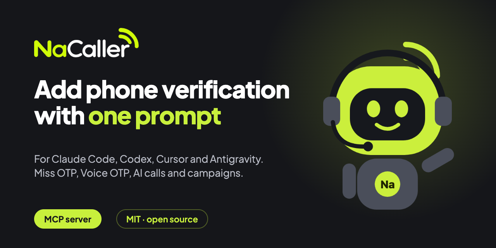
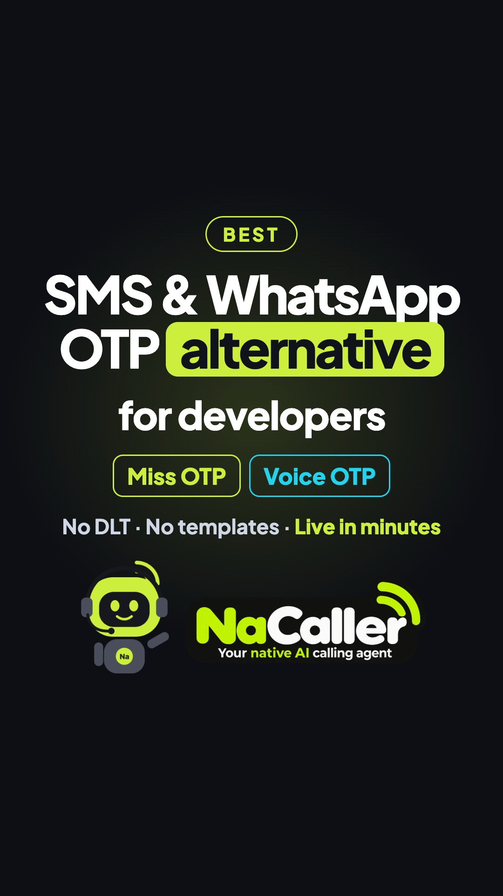
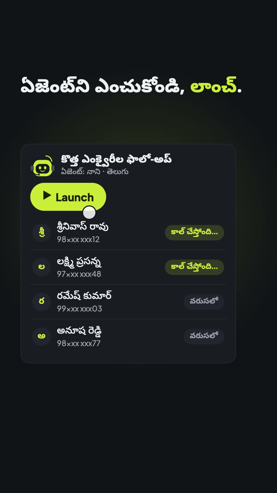
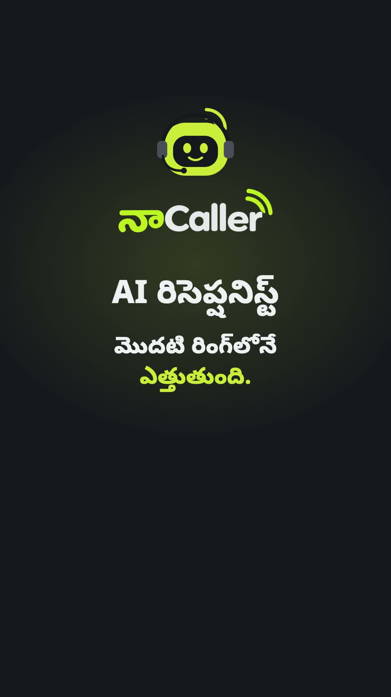

<p align="center"><a href="https://nacaller.com"></a></p>

<p align="center"><a href="https://nacaller.com/docs/ai-agents">Docs</a> · <a href="https://nacaller.com/openapi.json">OpenAPI</a> · <a href="https://nacaller.com/missed-call-otp">Miss OTP</a> · <a href="https://nacaller.com/voice-otp">Voice OTP</a> · <a href="LICENSE">MIT</a></p>

# NaCaller MCP server

Lets Claude Code, Codex, Cursor, Antigravity and other MCP-capable coding agents use NaCaller with your API key: send a Voice OTP, start a missed-call verification, place AI calls, run campaigns, read results and balance, and save agents and keypad flows as drafts for you to activate.


## Watch: Miss OTP and Voice OTP in 57 seconds

<p align="center"><a href="media/miss-otp-voice-otp-explainer.mp4"></a></p>

Click the picture to play the video: how Miss OTP (verify with one missed call) and Voice OTP (a call that reads the code aloud, in ten Indian languages) replace SMS and WhatsApp OTP, with no DLT registration.

### More videos

<table><tr>
<td align="center" width="25%"><a href="media/the-dlt-wait.mp4"></a><br><sub><b>The DLT wait</b><br>English, 30 s</sub></td>
<td align="center" width="25%"><a href="media/bulk-calling-campaigns.mp4"></a><br><sub><b>Bulk calling campaigns</b><br>Telugu, 22 s</sub></td>
<td align="center" width="25%"><a href="media/ai-receptionist.mp4"></a><br><sub><b>AI receptionist</b><br>Telugu, 21 s</sub></td>
<td align="center" width="25%"><a href="media/ten-languages.mp4"></a><br><sub><b>One agent, 10 languages</b><br>Telugu, 65 s</sub></td>
</tr></table>

Click a picture to play it.

## Keys

NaCaller has two key types today. Both are server secrets and go in environment variables only; this server never accepts a key as a tool argument and never prints one.

| Key | Looks like | Created in | Used by |
| --- | --- | --- | --- |
| Developer key | `nc_live_...` | Dashboard, Settings, Developers | `calls_*`, `agents_*`, `ivr_*`, `campaigns_*`, `balance_get`, `billing_topup_link` |
| Verification key | `nck_live_...` | Dashboard, Verify (one per site) | `otp_*` |

Set whichever you have in `NACALLER_API_KEY`. To use both, put the second in `NACALLER_OTP_KEY`. A tool whose key is missing returns a message saying which variable to set.

Optional: `NACALLER_API_BASE` (default `https://api.nacaller.com`), `NACALLER_MAX_CONTACTS` (campaign hard cap, default `100`).

## Connect your agent

Replace `nc_live_xxx` with your key. Never commit it.

**Claude Code**

```bash
claude mcp add nacaller -e NACALLER_API_KEY=nc_live_xxx -- npx -y github:talkingwp/nacaller-mcp
```

**Cursor** (`.cursor/mcp.json`)

```json
{ "mcpServers": { "nacaller": { "command": "npx", "args": ["-y", "github:talkingwp/nacaller-mcp"], "env": { "NACALLER_API_KEY": "nc_live_xxx" } } } }
```

**Codex** (`~/.codex/config.toml`)

```toml
[mcp_servers.nacaller]
command = "npx"
args = ["-y", "github:talkingwp/nacaller-mcp"]
env = { NACALLER_API_KEY = "nc_live_xxx" }
```

**Antigravity** (MCP config JSON, same shape as Cursor)

```json
{ "mcpServers": { "nacaller": { "command": "npx", "args": ["-y", "github:talkingwp/nacaller-mcp"], "env": { "NACALLER_API_KEY": "nc_live_xxx" } } } }
```

Check the key works without involving an agent (a harmless read, nothing is sent or called):

```bash
NACALLER_API_KEY=nc_live_xxx npx -y github:talkingwp/nacaller-mcp --selftest
```

## Tools

| Tool | Does | Key |
| --- | --- | --- |
| `otp_send_voice` | Real call that reads a 6-digit code in one of 10 languages (te hi en ta kn ml mr bn or gu) | verification |
| `otp_check` | Checks the code the person heard | verification |
| `otp_missed_call_start` | Starts a missed-call verification, returns the number to ring | verification |
| `otp_status` | pending / verified / expired | verification |
| `calls_place` | Places one real AI call | developer |
| `calls_list`, `calls_get` | Recent calls; one call with transcript and signed recording link | developer |
| `agents_list` | Your agents (ids and status for the tools above) | developer |
| `agents_get` | One agent in full: prompt, greeting, languages, status | developer, `agents` scope |
| `agents_create`, `agents_update` | Save an agent as a **draft**. A person must press Activate in the dashboard before it can call. Two-step with a confirmation token | developer, `agents` scope |
| `ivr_list`, `ivr_get`, `ivr_create`, `ivr_update` | Keypad (IVR) flows: strictly validated scripted calls, saved as drafts. Two-step for writes | developer, `agents` scope |
| `balance_get` | Wallet balance, plan minutes left, OTP credits. Read only | developer, `read` scope |
| `billing_topup_link` | A link a person opens, signed in, to add money. Charges nothing; the agent never pays | developer, `billing_link` scope |
| `campaigns_create` | Two-step: dry run plus confirmation token, then create. Capped by `NACALLER_MAX_CONTACTS` | developer |
| `campaigns_results` | Totals and one row per contact | developer |
| `nacaller_docs` | Bundled guidance and snippets: overview, otp, webhooks, calls, campaigns, errors, nextjs, express, django, laravel, html | none |

Also exposed: resource `nacaller://docs/integration-guide` and prompt `integrate_phone_verification`.

Deliberately not included: anything that moves money, changes billing or the account, activates an agent, deletes anything, creates or deletes keys, or reads other accounts.

### Campaign confirm step

`campaigns_create` without `confirmation_token` dials nothing. It returns the de-duplicated contact count, agent, calling hours and a token. Only a second call with identical arguments plus that token creates the campaign. Tokens are bound to the arguments, work once, expire in 10 minutes and die with the process. The API gives no cost estimate, so none is invented: calls are billed per connected minute from the owner's plan and wallet.

### Drafts and the confirm step for agents

`agents_create`, `agents_update`, `ivr_create` and `ivr_update` work like `campaigns_create`: the first call (no `confirmation_token`) saves nothing and returns a preview and a token; only a second call with identical arguments plus the token saves. What is saved is always a **draft**: it cannot place calls, run campaigns or answer a number (those answer `agent_draft`) until a person presses Activate on the Agents page in the dashboard. Neither this server nor the API can activate, and nothing here deletes. Editing a live agent puts it back to draft, which the preview warns about. With a test key (`nc_test_`) the whole flow is simulated and nothing is stored.

### Money

`balance_get` only reads. `billing_topup_link` returns a link to the dashboard's Add money page with the amount filled in; a person opens it signed in and pays. It charges nothing, stores nothing and is limited to five links an hour per key. The tool description tells the agent never to try to pay.

## Safety

- OTP and call tools with live keys place real phone calls and spend real credits or minutes. Prefer an `nc_test_` key (Settings, Developers, Test key): the same tools run against a simulation, nothing is called or charged, and the OTP code is always 123456. Give agents the narrowest scope (OTP only, Calling, Read only). The `agents` and `billing_link` scopes are only in Full access, so create a custom-scoped key if an agent needs one of them.
- Calls go out 9 am to 9 pm India time only; do-not-call numbers are refused by NaCaller.
- Each key has a daily call limit (default 200) and 300 requests a minute.

## Develop

```bash
npm install
npm test          # real server over stdio against a local mock of the API
```

Not available in NaCaller (so not in this server): an SDK, deleting agents or flows, activating an agent through the API, paying or charging through the API, recorded IVR audio and voice selection.

## About the author

Built by **A. Niraj Kumar**, Managing Partner and Lead Developer at Webchilly Infoways. He has been building for the web for **19+ years**, since 2007, shipping 2,500+ websites for 1,300+ clients worldwide (WordPress and full-stack: PHP, JavaScript, React, Next.js, PostgreSQL), and has focused on AI voice agents and communication platforms since 2025. NaCaller is the AI calling platform he built for Indian businesses.

[LinkedIn](https://www.linkedin.com/in/anirajkumar) · [nacaller.com](https://nacaller.com)
